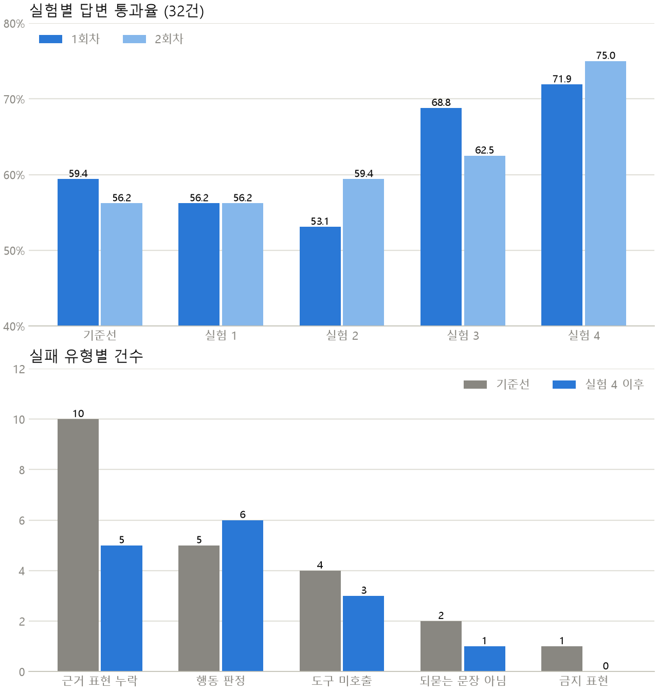

# 상담 챗봇 성능 개선 메모

쇼핑몰 상담 챗봇(문의 분류 → 조회 도구 호출 → 답변)을 고쳐 가며 두 지표를 올려 본 실험 기록입니다.
그 과정에서 얻은 아이디어를 적용한 **작은 상담 챗봇**(`chatbot.py`)도 함께 담았습니다. 바로 실행해 볼 수 있습니다.

## 바로 실행하기

필요한 것: Python 3.9 이상, OpenAI API 키

```bash
git clone https://github.com/Benji5526/agent-tuning-notes.git
cd agent-tuning-notes
pip install -r requirements.txt
```

API 키를 환경변수로 넣습니다.

```bash
# macOS / Linux / Git Bash
export OPENAI_API_KEY="sk-..."
```

```powershell
# Windows PowerShell
$env:OPENAI_API_KEY="sk-..."
```

대화를 시작합니다.

```bash
python chatbot.py
```

한 번만 묻고 끝낼 수도 있습니다.

```bash
python chatbot.py "제주도인데 배송비 추가로 붙어요?"
```

실행 예시 (`[도구]` 줄은 챗봇이 어떤 도구를 불렀는지 보여 줍니다).

```text
고객> 머그컵 얼마예요?
  [도구] search_product({'query': '머그컵'})
챗봇> 블루 머그컵과 화이트 머그컵 세트(2P) 중 어떤 상품을 말씀하시나요?

고객> 블루 머그컵이요. 3개 사면 배송비 있어요?
  [도구] search_product({'query': '블루 머그컵'})
  [도구] get_shipping_policy({'order_amount': None})
  [도구] get_product_detail({'product_id': 'P1'})
챗봇> 블루 머그컵은 1개 12,000원이라 3개면 36,000원입니다. 무료배송은 50,000원 이상부터라 배송비 3,000원이 있습니다.
```

- 모델은 기본값이 `gpt-5.6-terra`입니다. 계정에서 쓸 수 없으면 `CHATBOT_MODEL` 환경변수로 바꾸세요
  (예: `export CHATBOT_MODEL="gpt-4.1"`). 추론 모드와 함수 호출을 함께 못 쓰는 모델을 위해
  `reasoning_effort="none"`을 먼저 시도하고, 지원하지 않으면 빼고 다시 부릅니다.
- 상품과 주문은 `chatbot.py` 안의 가상 데이터("토이몰")입니다. 실제 쇼핑몰과 관계없습니다.
  `O-1001`, `O-1002` 주문번호와 머그컵, 에코백, 텀블러, 키링 상품으로 물어볼 수 있습니다.
- 한 번 부르면 API 호출이 몇 번 일어납니다(도구를 부를 때마다 한 번씩 더). 비용은 아주 작지만 0은 아닙니다.

## 이 챗봇이 하는 일

- 상품 이름이 나오면 먼저 `search_product`로 찾습니다. 후보가 하나로 정해지면 바로 조회하고, 여럿이면 되묻습니다.
- 재고, 무료배송 기준, 세트 단독 구매 가능 여부, 주문 상태는 도구로 조회한 값만 씁니다.
- 조회에 필요한 값(상품명, 주문번호, 지역)이 없으면 도구를 부르지 않고 질문으로 끝납니다.
- 조회 결과의 표현("품절" 등)과 수치는 바꿔 쓰지 않습니다.

이 챗봇은 성능 개선 실험에서 효과가 있던 두 가지를 담은 **최소 구현**입니다. 문의 분류 단계와 답변 숫자 검증(가드레일)은 넣지 않았습니다.

## 실험 결과 요약



| 지표 | 시작 | 개선 후 |
| --- | --- | --- |
| 문의 분류 정확도 | 0.93~0.94 | 0.93~0.95 (노이즈 범위, 사실상 변화 없음) |
| 첫 턴 답변 통과율 | 56~59% | 69~75% |

측정은 실험마다 두 번씩 했고, 같은 설정도 매번 3~6%p 흔들렸습니다. 답변 평가는 32건이라 한 건이 약 3%p입니다.
이 수치는 수업에서 제공한 별도 소스와 평가 문항으로 잰 것이라, 위 `chatbot.py`로는 **재현되지 않습니다**.

### 한 번에 하나만 바꾼 실험

| # | 바꾼 것 | 답변 통과율 | 결과 |
| --- | --- | --- | --- |
| 1 | 문의 유형별로 쓸 도구를 프롬프트에 표로 안내 | 56% / 56% | 효과 없음, 되돌림 |
| 2 | 상품 검색 점수에 희귀 단어 가중치 적용 | 53% / 59% | 버그 수정. 점수는 노이즈 범위 |
| 3 | 조회 결과의 표현과 수치를 그대로 쓰라는 규칙 추가 | 69% / 63% | 근거 표현 누락 실패가 절반으로 감소 |
| 4 | 되물을지 조회할지 판단하는 기준 명시 | 72% / 75% | 되묻기·조회 판단 실패 감소 |
| 5 | 분류 프롬프트에 예시 추가 | 분류 0.95 / 0.94 | 노이즈 범위 |

## 배운 것

- **점수보다 실패 사례를 읽는 게 먼저였습니다.** "도구를 안 부른다"는 증상의 원인이 프롬프트가 아니라
  검색 도구의 동점 처리였습니다. 프롬프트에 도구 안내표를 넣은 실험 1이 실패한 이유도 그 때문입니다.
  증상이 같아도 원인을 확인하기 전에는 고치는 위치를 정할 수 없었습니다.
- **채점 방식이 행동을 정의합니다.** 채점기가 "문자열이 그대로 들어 있는가"를 보기 때문에, 답이 맞아도
  표현을 바꿔 쓰면 틀린 것으로 처리됐습니다. 그래서 근거 표현을 바꾸지 말라는 규칙이 효과가 컸습니다.
  다만 이 규칙은 채점 방식에 맞춘 면이 있고, 실제 고객 응대에서도 정확한 표현이 더 낫다는 점은 따로 확인하지 않았습니다.
- **채점기로는 통과할 수 없는 문항이 있었습니다.** 범위 밖 문의를 도구 없이 정확히 거절해도 ANSWER로
  판정되는 문항이 하나 있었습니다. 채점 기준을 고치면 점수만 오르므로 그대로 두고 한계로 기록했습니다.
- **평가 문항은 프롬프트에 넣지 않았습니다.** 분류 예시는 따로 제공된 예시용 데이터에서만 가져왔고,
  평가 오답을 보고 규칙을 추가하는 것도 하지 않았습니다.
- **LLM 평가는 흔들립니다.** 한 번 재고 판단하지 않고 두 번씩 쟀습니다. 그래도 5%p 이내 차이는
  개선이라고 말하기 어렵습니다.

## 파일

- `chatbot.py`: 바로 실행되는 상담 챗봇.
- `rarity_weighted_search.py`: 실험 2의 핵심. 흔한 단어("세트")의 영향을 줄이는 검색 점수. 챗봇이 이 파일을 불러 씁니다.
  단독 실행(`python rarity_weighted_search.py`)하면 예시 결과를 볼 수 있습니다.
- `prompt_rules.md`: 실험 3·4에서 추가한 프롬프트 규칙을 일반화해 다시 쓴 것.
- `make_chart.py`, `results.png`: 실험 결과 차트와 그것을 만드는 코드 (`matplotlib` 필요).
